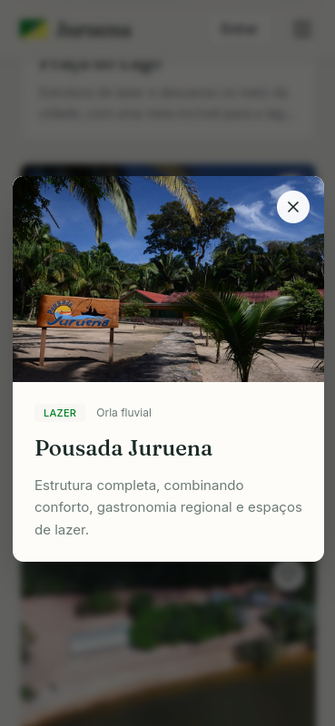
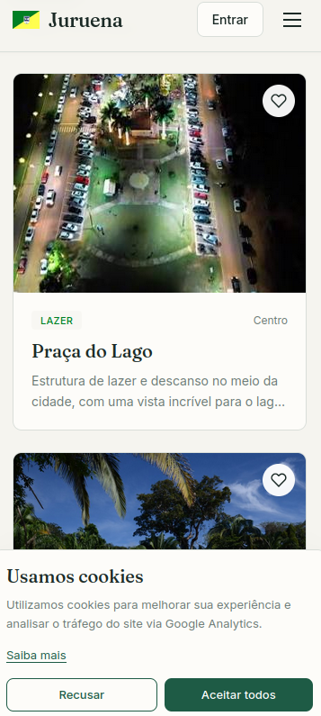

# Juruena - Guia Regional e Cultural

Guia digital de lugares, cultura e sabores de Juruena, Mato Grosso.

> **Status:** Etapa 1 - Frontend concluída. Backend e integração full-stack nas próximas entregas.

**Deploy:** https://michael-ribeiro-fs.github.io/juruena-fullstack/


---

## Problema

Juruena é um município do noroeste de Mato Grosso, marcado por sua relação com a natureza e a diversidade da região amazônica. Apesar de ser um destino rico em ecossistemas, cultura ribeirinha e tradições sustentáveis (como a colheita da castanha-do-brasil), **não existe uma plataforma digital centralizada** que reúna informações sobre lugares, história e dados práticos da cidade.

Turistas e moradores enfrentam:

- Falta de informação consolidada sobre pontos turísticos
- Ausência de dados climáticos em tempo real
- Nenhum canal digital para colaboração comunitária (sugestão de lugares)

---

## Solução

O **Juruena - Guia Regional e Cultural** é uma SPA (Single Page Application) construída com React + Vite que oferece:

- **Landing page** com hero, seção sobre a cidade, clima em tempo real e prévia do catálogo
- **Catálogo completo de lugares** (`/lugares`) com busca textual, filtros por categoria e empty state
- **Página de favoritos** (`/favoritos`) protegida por rota, com estrutura pronta para autenticação
- **Clima em tempo real** via [Open-Meteo API](https://open-meteo.com/) (pública, sem autenticação)
- **Modal de detalhes** (lightbox) ao clicar em um lugar
- **Popup de autenticação** com validação client-side inline
- **Banner de cookies** em conformidade com a LGPD, com persistência em `localStorage`
- **Design responsivo mobile-first**, com design system em tokens CSS
- **32 testes automatizados** cobrindo funções puras, services e contratos de dados

### Screenshots

**Home**


**Modal de detalhes do lugar**



**Popup de autenticação (desktop)**


**Popup de autenticação (mobile)**



---

## Arquitetura

Estrutura organizada por responsabilidade, sem misturar camadas:

```text
frontend/
├── public/                  # Assets estáticos (favicon, screenshots)
├── src/
│   ├── assets/images/       # Imagens importadas via Vite
│   ├── components/          # Componentes reutilizáveis
│   │   ├── About/           # Seção "Sobre a Cidade"
│   │   ├── AuthPopup/       # Popup de login/cadastro
│   │   ├── CookieBanner/    # Banner LGPD
│   │   ├── CTA/             # Call-to-action final
│   │   ├── Footer/          # Rodapé
│   │   ├── Header/          # Cabeçalho com variant + hamburguer mobile
│   │   ├── Hero/            # Hero da home
│   │   ├── PlaceCard/       # Card de lugar (favoritar + modal)
│   │   ├── PlaceModal/      # Modal lightbox de detalhes
│   │   ├── Places/          # Seção de lugares da home
│   │   ├── ProtectedRoute/  # HOC de rota protegida
│   │   └── Weather/         # Clima (recebe dados via props)
│   ├── contexts/            # CurrentUserContext
│   ├── hooks/               # Reservado para hooks customizados
│   ├── pages/               # Páginas roteadas
│   │   ├── MainPage/        # Home
│   │   ├── PlacesPage/      # Catálogo
│   │   ├── FavoritesPage/   # Favoritos (protegida)
│   │   └── NotFoundPage/    # 404
│   ├── services/            # Integrações com API
│   │   └── weatherApi.js    # Open-Meteo
│   ├── styles/              # Design system
│   │   ├── tokens.css       # Variáveis (cores, fontes, espaçamentos)
│   │   ├── global.css       # Reset + base
│   │   └── layout.css       # Helpers (.container)
│   ├── utils/               # Funções puras testáveis
│   │   └── filterPlaces.js
│   ├── vendor/              # Recursos de terceiros
│   │   ├── fonts/           # Fraunces + Inter (woff2)
│   │   ├── fonts.css
│   │   └── normalize.css
│   ├── App.jsx              # Orquestrador (fetch, rotas, popup, banner)
│   └── main.jsx             # Entry point
├── index.html
├── package.json
├── vite.config.js
└── .eslintrc.json
```

**Princípios aplicados:**

- **Cada componente tem 3 arquivos:** `Componente.jsx`, `Componente.css` e `data.js`
- **Dados estáticos em `data.js`:** zero conteúdo hardcoded no JSX
- **Design system em `tokens.css`:** alterar `--color-primary` reflete em todo o projeto
- **App como orquestrador:** fetch, rotas e estado global ficam centralizados no `App`
- **Componentes presentational:** `Weather` recebe dados via props e não faz fetch
- **Testes colocados:** cada `.test.js` fica ao lado do arquivo testado

---

## Decisões Técnicas

| Decisão                        | Justificativa                                                                              |
| ------------------------------ | ------------------------------------------------------------------------------------------ |
| **React 19 + Vite**            | Stack exigida pelo curso; Vite oferece HMR rápido e build otimizado                        |
| **React Router v5**            | Requisito do checklist (`<Switch>`, `<Route>`, `<Redirect>`, `useHistory()`), em vez da v6 |
| **BEM + `className`**          | Nomenclatura CSS consistente e sem conflitos                                               |
| **Design tokens CSS**          | Paleta inteira alterável em um único arquivo (`tokens.css`), sem refactor                  |
| **Mobile-first**               | Media queries com `min-width`; sem scroll horizontal a partir de 320px                     |
| **Fontes self-hosted (woff2)** | Melhor performance (sem request externo) e sem dependência do Google Fonts                 |
| **Open-Meteo API**             | Pública, gratuita e sem chave de API; nenhuma conta necessária                             |
| **Vitest**                     | Integração nativa com Vite (sintaxe compatível com Jest, sem Babel)                        |
| **32 testes unitários**        | Cobrem funções puras, services (mock de `fetch`) e contratos de constantes                 |
| **Validação client-side**      | Erro inline em tempo real + `aria-invalid` para acessibilidade                             |
| **Banner de cookies (LGPD)**   | Aceitar/Recusar persiste em `localStorage`; o Google Analytics só roda com consentimento   |
| **ProtectedRoute (HOC)**       | Estrutura pronta para autenticação real (Etapa 3); hoje redireciona usuários deslogados    |
| **`eslint-disable` proibido**  | Conforme o checklist; exceções são configuradas em `.eslintrc.json`                        |

---

## Como Executar

### Pré-requisitos

- Node.js 18+ (recomendado 20+)
- npm 9+

### Instalação

```bash
# Clone o repositório
git clone https://github.com/michael-ribeiro-fs/juruena-fullstack.git
cd juruena-fullstack/frontend

# Instale as dependências
npm install
```

### Desenvolvimento

```bash
npm run dev
# Abra http://localhost:3000
```

### Testes

```bash
npm test             # Roda os 32 testes uma vez
npm run test:watch   # Modo watch (útil durante o desenvolvimento)
```

### Lint

```bash
npm run lint             # Verifica erros de ESLint
npm run lint -- --fix    # Corrige automaticamente
```

### Build de produção

```bash
npm run build     # Gera a pasta dist/
npm run preview   # Preview local do build
```

---

## Endpoints

Nesta etapa o frontend consome apenas uma API externa (Open-Meteo) via `fetch`, com as requisições centralizadas em `src/services/weatherApi.js`.

### Open-Meteo Forecast API

```text
GET https://api.open-meteo.com/v1/forecast
```

| Parâmetro       | Valor                                                | Descrição                  |
| --------------- | ---------------------------------------------------- | -------------------------- |
| `latitude`      | `-10.318`                                            | Coordenada de Juruena - MT |
| `longitude`     | `-58.359`                                            | Coordenada de Juruena - MT |
| `current`       | `temperature_2m,apparent_temperature,weather_code`   | Dados atuais               |
| `daily`         | `weather_code,temperature_2m_max,temperature_2m_min` | Previsão diária            |
| `timezone`      | `auto`                                               | Fuso horário automático    |
| `forecast_days` | `4`                                                  | Hoje + 3 dias              |

- **Autenticação:** nenhuma (API pública)
- **Rate limit:** 600 requisições/minuto por IP
- **Documentação oficial:** [open-meteo.com/en/docs](https://open-meteo.com/en/docs)

**Código consumidor:**

- `src/services/weatherApi.js` → `fetchWeather()`
- `src/App.jsx` → `useEffect` que chama `fetchWeather()`
- `src/components/Weather/Weather.jsx` → exibe os dados recebidos via props

### Rotas internas (React Router v5)

| Rota         | Componente                             | Protegida? |
| ------------ | -------------------------------------- | ---------- |
| `/`          | `MainPage`                             | Não        |
| `/lugares`   | `PlacesPage`                           | Não        |
| `/favoritos` | `FavoritesPage` (via `ProtectedRoute`) | Sim        |
| `*`          | `NotFoundPage`                         | —          |

---

## Próximos Passos

Este projeto está na **Etapa 1 (Frontend)** do bootcamp. As próximas etapas planejadas são:

### Etapa 2 — Backend (Node / Express / MongoDB)

- API REST com `POST /signup`, `POST /signin` e `GET /users/me`
- Autenticação JWT com hash de senha via bcrypt
- CRUD de favoritos (`GET /places`, `POST /favorites`, `DELETE /favorites/:id`)
- Validação com Celebrate/Joi, logs com Winston e rate limit com Express Rate Limit
- Deploy em Render ou Railway

### Etapa 3 — Integração Full-Stack

- `services/authApi.js` com `signUp`, `signIn` e `getCurrentUser`
- `CurrentUserContext.Provider` populado via `/users/me`
- Botão de favoritar com persistência real (`POST`/`DELETE`)
- Popup de autenticação com `fetch` real (em vez de `console.log`)
- `ProtectedRoute` funcionando com autenticação real

### Melhorias contínuas

- [ ] Substituir as imagens externas (URLs do Google) por imagens locais
- [ ] Integrar o Google Analytics ao consentimento do banner de cookies
- [ ] Criar a página `/privacidade` com a política de cookies completa
- [ ] Adicionar o botão "Gerenciar cookies" no Footer (permitir revogar consentimento)
- [ ] Testes E2E com Playwright (fora do escopo do curso)
- [ ] PWA (offline-first e instalável)

---

## Licença

2026 Michael Ribeiro

Este projeto foi desenvolvido como parte do projeto final do bootcamp de Desenvolvimento Full-Stack da TripleTen (Sprint 19).
